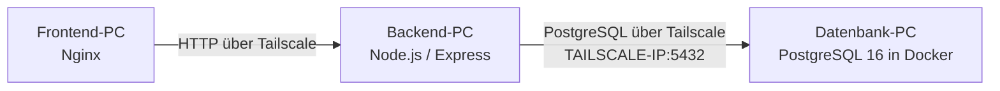

# CloudNova-Datenbank über Tailscale

Diese Anleitung dokumentiert den Datenbank-PC der CloudNova-Drei-PC-Variante. PostgreSQL läuft in Docker und ist ausschließlich über die Tailscale-IP des Datenbank-PCs erreichbar.

## Architektur



| Bestandteil | Wert |
| --- | --- |
| Projektordner | lokaler Klon des CloudNova-Repositorys |
| Compose-Datei | `deploy/compose.db.yml` |
| Umgebungsdatei | `deploy/.env` |
| Compose-Projekt | `cloudnova-db` |
| Service | `database` |
| Container | `cloudnova-db-database-1` |
| Docker-Image | `postgres:16-alpine` |
| Tailscale-Endpunkt | `<TAILSCALE-IP-DATENBANK-PC>:5432` |
| Persistentes Volume | `cloudnova-db_db_data` |

## Voraussetzungen

- Docker Desktop läuft auf dem Datenbank-PC.
- Tailscale ist auf allen drei PCs aktiv.
- Die aktuelle Tailscale-IP des Datenbank-PCs ist bekannt.
- `deploy/.env` ist vorhanden und enthält die benötigten Werte.
- Die Tailscale-ACL beziehungsweise die Windows-Firewall erlaubt dem Backend-PC den Zugriff auf TCP-Port `5432`.

## Konfiguration

Die Datei `deploy/compose.db.yml` startet nur den Datenbankdienst. PostgreSQL wird nicht an alle Netzwerkschnittstellen gebunden, sondern ausschließlich an die in `DB_BIND` eingetragene Tailscale-IP.

Die Datei `deploy/.env` benötigt auf dem Datenbank-PC mindestens:

```dotenv
POSTGRES_DB=cloudnova
POSTGRES_USER=cloudnova_admin
POSTGRES_PASSWORD=<sicheres-Admin-Passwort>
APP_DB_USER=cloudnova_app
APP_DB_PASSWORD=<sicheres-App-Passwort>
DB_BIND=<TAILSCALE-IP-DATENBANK-PC>
```

> **Wichtig:** Echte Passwörter niemals in Git, Tickets, Screenshots oder Chats einfügen. Die lokale Datei `deploy/.env` darf nicht committed werden.

`APP_DB_PASSWORD` muss auf dem Datenbank-PC und dem Backend-PC identisch sein. Die Weitergabe erfolgt ausschließlich über einen sicheren Kanal, zum Beispiel einen Passwortmanager.

## Datenbank starten

PowerShell im Projektordner öffnen:

```powershell
cd <PFAD-ZUM-CLOUDNOVA-REPOSITORY>
docker compose --env-file deploy/.env -f deploy/compose.db.yml up -d database
```

Beim ersten Start lädt Docker das Image `postgres:16-alpine`, erstellt das persistente Volume und führt die Initialisierung aus `database/init` aus. Bei späteren Starts wird das vorhandene Volume weiterverwendet.

## Status prüfen

### Compose-Status

```powershell
docker compose --env-file deploy/.env -f deploy/compose.db.yml ps
```

Erwarteter Status:

```text
cloudnova-db-database-1   ...   Up ... (healthy)   <TAILSCALE-IP>:5432->5432/tcp
```

### Docker-Healthcheck

```powershell
docker inspect --format '{{.State.Status}} {{.State.Health.Status}}' cloudnova-db-database-1
```

Erwartete Ausgabe:

```text
running healthy
```

### PostgreSQL direkt prüfen

```powershell
docker exec cloudnova-db-database-1 sh -c 'pg_isready -U "$POSTGRES_USER" -d "$POSTGRES_DB"'
```

Erwartete Ausgabe:

```text
/var/run/postgresql:5432 - accepting connections
```

`running` bedeutet, dass der Container läuft. `healthy` bestätigt den Docker-Healthcheck. `accepting connections` bestätigt zusätzlich, dass PostgreSQL Verbindungen annimmt.

## Backend verbinden

Auf dem Backend-PC müssen die Datenbankwerte zur Datenbank passen:

```dotenv
DB_HOST=<TAILSCALE-IP-DATENBANK-PC>
POSTGRES_DB=cloudnova
APP_DB_USER=cloudnova_app
APP_DB_PASSWORD=<dasselbe-App-Passwort-wie-auf-dem-Datenbank-PC>
```

Der Backend-PC verbindet sich mit:

- Host: Tailscale-IP des Datenbank-PCs
- Port: `5432`
- Datenbank: `cloudnova`
- Benutzer: `cloudnova_app`

Der eingeschränkte App-Benutzer wird für den normalen Backend-Zugriff verwendet. Der Admin-Benutzer ist nicht für den laufenden Anwendungsbetrieb vorgesehen.

## Datenbank stoppen und erneut starten

Container stoppen, ohne Daten zu löschen:

```powershell
docker compose --env-file deploy/.env -f deploy/compose.db.yml stop database
```

Container erneut starten:

```powershell
docker compose --env-file deploy/.env -f deploy/compose.db.yml start database
```

Alternativ kann `up -d database` jederzeit erneut ausgeführt werden. Das persistente Volume bleibt erhalten.

## Fehlerbehebung

### `no configuration file provided: not found`

Der Befehl wurde im falschen Ordner oder ohne `-f` ausgeführt. In den Projektordner wechseln und die Compose-Datei ausdrücklich angeben:

```powershell
cd <PFAD-ZUM-CLOUDNOVA-REPOSITORY>
docker compose --env-file deploy/.env -f deploy/compose.db.yml ps
```

### Docker-Engine nicht erreichbar

Typische Meldung:

```text
open //./pipe/dockerDesktopLinuxEngine: The system cannot find the file specified
```

Docker Desktop starten, warten bis die Engine bereit ist und den Befehl erneut ausführen.

### Fehlende Variable aus `deploy/.env`

Wenn Compose zum Beispiel `POSTGRES_DB fehlt` oder `DB_BIND fehlt` meldet, prüfen:

1. Die Datei heißt exakt `deploy/.env`.
2. Der Befehl enthält `--env-file deploy/.env`.
3. Alle benötigten Werte sind gesetzt.
4. `DB_BIND` enthält die aktuelle Tailscale-IP des Datenbank-PCs.

Die aktuelle Tailscale-IP kann auf diesem PC mit folgendem Befehl geprüft werden:

```powershell
& 'C:\Program Files\Tailscale\tailscale.exe' ip -4
```

### Container bleibt `unhealthy`

Status und Logs prüfen:

```powershell
docker compose --env-file deploy/.env -f deploy/compose.db.yml ps
docker compose --env-file deploy/.env -f deploy/compose.db.yml logs --tail 100 database
```

Häufige Ursachen sind eine fehlerhafte `.env`, ein bereits belegter Port oder Probleme bei der ersten Initialisierung.

### Backend erreicht die Datenbank nicht

Prüfen:

1. Beide PCs sind in Tailscale online.
2. `DB_HOST` auf dem Backend-PC entspricht der aktuellen Tailscale-IP des Datenbank-PCs.
3. `APP_DB_PASSWORD` stimmt auf Datenbank- und Backend-PC überein.
4. Tailscale-ACL und Windows-Firewall erlauben TCP `5432` vom Backend-PC.
5. Der Datenbankcontainer zeigt `healthy`.

## Datensicherheit

Die Daten liegen im Docker-Volume `cloudnova-db_db_data` und bleiben bei `stop`, `start`, `restart` und normalem `docker compose down` erhalten.

Keine Befehle mit `down -v`, `volume rm`, `docker system prune --volumes` oder vergleichbaren Volume-Löschoptionen verwenden. Diese können die Datenbank unwiederbringlich entfernen.

